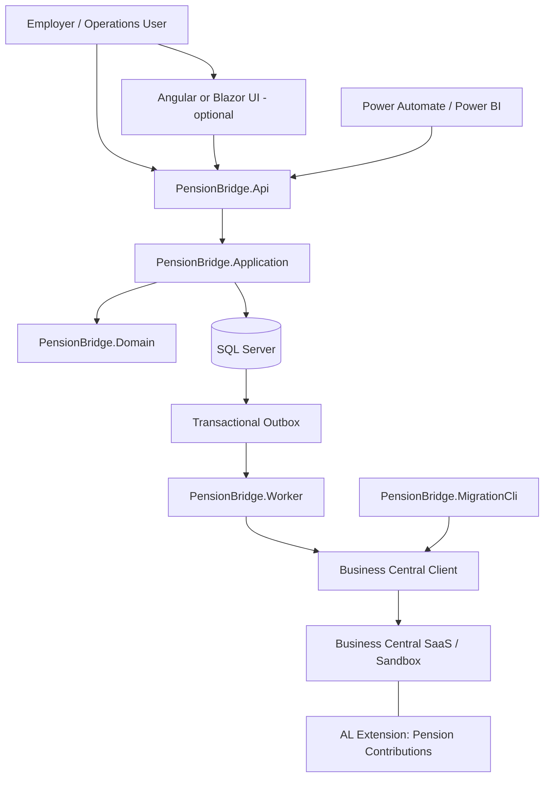
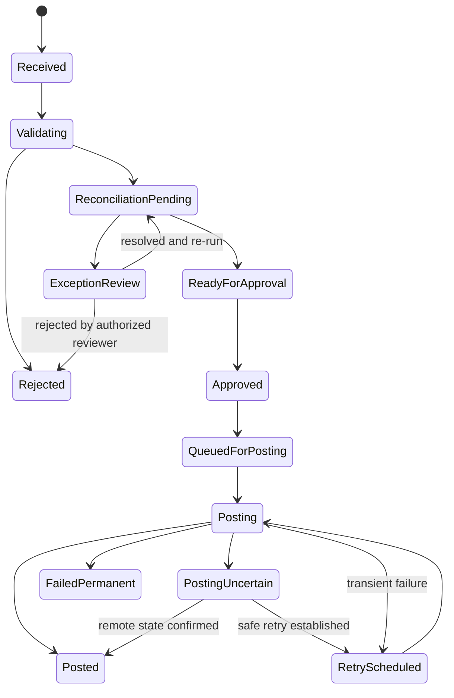
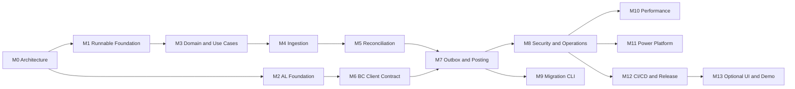

# PensionBridge

**Business Central-integrated pension and insurance contributions platform**

> An implementation-ready engineering blueprint for a hybrid Microsoft Dynamics 365 Business Central + C#/.NET platform. This README defines the architecture, repository scaffold, milestones, code-generation deliverables, acceptance criteria, testing strategy, and delivery gates. It is a plan—not a claim that the implementation already exists.

[](#technology-baseline)
[](#architecture)
[](#architecture)
[](#delivery-governance)

## 1. Product vision

PensionBridge receives monthly employer contribution submissions, validates them against pension scheme and member records, reconciles financial totals, routes exceptions for approval, and posts approved contributions to Microsoft Dynamics 365 Business Central. It then exposes traceable processing statuses and operational reports to authorized users and downstream Power Platform tools.

The project is designed to demonstrate both sides of a Business Central integration role:

- **AL extension:** Business Central-native tables, pages, API pages, posting codeunits, permissions, upgrade logic, and AL tests.
- **C#/.NET integration platform:** domain logic, ingestion, validation, reconciliation, durable orchestration, Business Central API client, outbox-driven posting worker, audit trail, and migration tooling.

The repository must remain useful even without a live Business Central tenant. Unit tests and contract tests run locally; end-to-end Business Central tests are enabled when a configured sandbox or supported container environment is available.

## 2. Business outcomes and scope

### Core workflow

1. Register schemes, employer organizations, and member identifiers.
2. Upload a contribution file (CSV first; Excel can follow) or submit through an authenticated API.
3. Validate the file structure, scheme, member references, contribution periods, amounts, and duplicates.
4. Reconcile submitted totals against expected totals and configured rules.
5. Place invalid or suspicious rows into an exception workflow; require authorized review where policy demands it.
6. Approve a valid batch and create durable posting commands.
7. Post to Business Central using supported standard APIs where possible and versioned custom AL API pages where required.
8. Capture Business Central document identifiers, posting results, and failures.
9. Produce batch-level and row-level reports with an auditable history.

### In scope

- Multi-scheme and multi-company mapping.
- Employer and employee contributions, voluntary contributions, and configurable fund buckets.
- Duplicate detection and idempotent processing.
- Reconciliation rules for missing members, duplicate submissions, amount mismatches, late submissions, and configurable penalty/interest calculations.
- Exception review and approval.
- Immutable application audit events and posting-attempt history.
- Retryable background processing, dead-letter state, and operational replay controls.
- Business Central integration using Microsoft Entra ID OAuth 2.0 and supported API/OData interfaces.
- Data migration CLI with dry-run, validation, and reconciliation reports.
- CI checks, security checks, operational documentation, and performance evidence.

### Explicitly out of scope for the initial release

- Replacing Business Central's general ledger or pension administration system.
- Unreviewed automatic posting of batches containing unresolved exceptions.
- Storing client secrets in source control.
- Claiming regulatory compliance before a formal requirements and controls review.
- Depending on undocumented Business Central endpoints or bypassing standard posting validations.

## 3. Architecture



### Architectural boundaries

- **Domain** contains business entities, value objects, domain policies, and invariants. It must not depend on EF Core, ASP.NET Core, Business Central SDKs, or infrastructure services.
- **Application** contains use cases, commands/queries, ports, validation orchestration, authorization requirements, and transaction boundaries.
- **Infrastructure** implements persistence, Business Central connectivity, file storage, messaging/outbox persistence, and external adapters.
- **API** is the HTTP boundary: authentication, request/response contracts, endpoint composition, OpenAPI, health endpoints, and centralized error handling.
- **Worker** processes durable outbox messages and posting commands independently of HTTP request lifetimes.
- **AL extension** owns Business Central-side schema and supported BC-native operations. It does not duplicate the entire .NET workflow engine.
- **Migration CLI** reuses application contracts and integration abstractions; it supports dry-run by default and requires an explicit flag for writes.

### Critical design rules

1. Do not report a batch as posted until Business Central confirms the outcome.
2. Do not assume an HTTP timeout means a posting failed; query/reconcile remote state before retrying an uncertain operation.
3. Use a stable idempotency key for each logical posting command and persist it before dispatch.
4. Keep batch validation and posting state transitions explicit and auditable.
5. Never store access tokens, client secrets, full member identifiers, or contribution payloads in ordinary logs.
6. Use decimal arithmetic for money; define currency, rounding, precision, and period rules explicitly.
7. Treat a printer/notification/reporting failure as independent of a successful financial posting.
8. Prefer standard Business Central APIs where they meet requirements; introduce custom AL APIs only for documented gaps.
9. Use optimistic concurrency (ETags where supported) for mutable remote records.
10. Retries must be bounded, observable, and safe for idempotent operations.

## 4. Repository tree scaffold

The tree below is the target structure. Create only the files needed by the current milestone; do not generate empty projects or placeholder implementations simply to make the tree look complete.

```text
pensionbridge/
├── README.md
├── LICENSE
├── .editorconfig
├── .gitignore
├── global.json
├── Directory.Build.props
├── Directory.Packages.props
├── PensionBridge.sln
├── docker-compose.yml
├── .env.example
├── src/
│   ├── PensionBridge.Domain/
│   │   ├── Schemes/
│   │   ├── Employers/
│   │   ├── Members/
│   │   ├── Contributions/
│   │   ├── Batches/
│   │   ├── Reconciliation/
│   │   ├── Exceptions/
│   │   ├── Posting/
│   │   ├── Audit/
│   │   └── Common/
│   ├── PensionBridge.Application/
│   │   ├── Abstractions/
│   │   ├── Schemes/
│   │   ├── Members/
│   │   ├── Ingestion/
│   │   ├── Validation/
│   │   ├── Reconciliation/
│   │   ├── Exceptions/
│   │   ├── Approval/
│   │   ├── Posting/
│   │   └── Reporting/
│   ├── PensionBridge.Contracts/
│   │   ├── Requests/
│   │   ├── Responses/
│   │   ├── Events/
│   │   └── Common/
│   ├── PensionBridge.Infrastructure/
│   │   ├── Persistence/
│   │   │   ├── Configurations/
│   │   │   ├── Migrations/
│   │   │   └── Repositories/
│   │   ├── BusinessCentral/
│   │   ├── Outbox/
│   │   ├── Files/
│   │   ├── Security/
│   │   └── Observability/
│   ├── PensionBridge.Api/
│   │   ├── Endpoints/
│   │   ├── Middleware/
│   │   ├── Authorization/
│   │   └── OpenApi/
│   ├── PensionBridge.Worker/
│   │   ├── Posting/
│   │   ├── Outbox/
│   │   └── Health/
│   └── PensionBridge.MigrationCli/
├── al/
│   └── PensionBridge.BC/
│       ├── app.json
│       ├── .vscode/
│       ├── src/
│       │   ├── Tables/
│       │   ├── TableExtensions/
│       │   ├── Pages/
│       │   ├── ApiPages/
│       │   ├── Codeunits/
│       │   ├── Enums/
│       │   ├── Permissions/
│       │   └── Upgrade/
│       └── test/
│           ├── TestCodeunits/
│           └── Fixtures/
├── tests/
│   ├── PensionBridge.Domain.Tests/
│   ├── PensionBridge.Application.Tests/
│   ├── PensionBridge.Infrastructure.Tests/
│   ├── PensionBridge.Api.Tests/
│   ├── PensionBridge.Integration.Tests/
│   ├── PensionBridge.Architecture.Tests/
│   └── al/
├── powerplatform/
│   ├── connector/
│   ├── power-automate/
│   └── power-bi/
├── db/
│   ├── scripts/
│   └── perf/
│       ├── datasets/
│       ├── queries/
│       ├── results/
│       └── README.md
├── tools/
│   └── scripts/
├── docs/
│   ├── architecture/
│   │   ├── context.md
│   │   ├── containers.md
│   │   └── decisions/
│   ├── requirements/
│   ├── domain/
│   ├── ooad/
│   ├── uml/
│   ├── database/
│   ├── business-central/
│   ├── al-upgrades/
│   ├── security/
│   ├── testing/
│   ├── operations/
│   ├── migration/
│   └── demos/
└── .github/
    ├── workflows/
    │   ├── dotnet-ci.yml
    │   ├── al-ci.yml
    │   ├── security.yml
    │   └── release.yml
    ├── ISSUE_TEMPLATE/
    └── pull_request_template.md
```

## 5. Technology baseline

Pin versions and SDK selection in repository configuration. The baseline below is intentional but must be verified against the actual target environment before implementation.

| Area | Baseline | Notes |
|---|---|---|
| Backend | C# / ASP.NET Core on .NET 10 | Use the installed supported SDK; avoid preview dependencies unless explicitly justified. |
| API documentation | OpenAPI + Scalar | Publish the OpenAPI document; protect non-development documentation endpoints as appropriate. |
| Persistence | SQL Server + EF Core | Use migrations, explicit indexes, transaction boundaries, and reviewed query plans. |
| Hot-path data access | Dapper only where measured | Do not introduce a second data-access approach without a demonstrated need. |
| Background processing | .NET Worker + transactional outbox | Use a durable database-backed outbox first; add a broker only when justified. |
| Resilience | Microsoft.Extensions.Http.Resilience or Polly | Choose one consistent strategy; avoid nested retries. |
| Validation | Domain invariants + application validation | Transport validation is not a substitute for business validation. |
| Authentication | Microsoft Entra ID / OAuth 2.0 | Use managed identity where supported; otherwise use securely stored credentials. |
| Business Central | Standard APIs/OData + custom AL API pages as needed | Validate exact API availability and permissions in the target tenant/version. |
| AL tooling | VS Code AL extension; compiler in CI where licensed/tooling permits | AL compilation and BC-hosted tests may need a configured environment. |
| Tests | xUnit, integration tests, WireMock.Net, Testcontainers where supported | Container-backed SQL Server tests may require Docker and an appropriate SQL Server image/license. |
| CI/CD | GitHub Actions | Build, test, lint/compile, scan, package, and publish artifacts as separate steps. |
| UI | Optional Angular or Blazor | Start only after the API workflow is stable. |
| Power Platform | OpenAPI custom connector, Power Automate, Power BI | Deliver exports and setup notes; tenant deployment is environment-specific. |

## 6. Domain model and financial invariants

### Initial aggregates

- **Scheme** — scheme code, name, Business Central company mapping, currency, contribution policies, status.
- **Employer** — employer code, identity, assigned schemes, status.
- **Member** — scheme-scoped member number, external reference, membership dates, status.
- **ContributionBatch** — employer, scheme, period, source file metadata, state, row counts, control totals, submission idempotency key.
- **ContributionLine** — member, contribution components, source row number, validation outcomes, reconciliation outcomes.
- **ReconciliationResult** — rule, severity, expected/actual values, evidence reference, resolution state.
- **ExceptionCase** — exception type, assignment, comments, approval decision, timestamps.
- **PostingCommand** — stable idempotency key, batch/line references, target company, payload hash, state, attempts, remote identifiers.
- **AuditRecord** — actor, action, aggregate reference, timestamp, correlation ID, redacted change summary.

### Invariants to encode and test

1. Monetary values use `decimal`; never use binary floating-point for financial calculations.
2. A contribution line must belong to a known batch, scheme, employer, and valid contribution period.
3. Scheme/member relationships and membership dates must be validated before approval.
4. A batch cannot be approved while blocking exceptions remain unresolved.
5. Batch control totals must equal the sum of accepted line totals according to the documented rounding policy.
6. A posting command cannot transition from confirmed success back to pending.
7. Replaying a command with the same idempotency key must not create a second logical posting.
8. Reversal is a new, explicitly linked compensating operation; never silently edit a posted financial entry.
9. Every state transition records actor/system identity, timestamp, correlation ID, and reason where applicable.
10. Scheme-to-company mapping must be explicit and validated; never select a Business Central company by an implicit default.

### Batch state machine



Document permitted transitions and their guards in code. Do not rely on arbitrary string assignments to manage workflow state.

## 7. Milestone roadmap

Milestones are ordered to produce a demonstrable, testable vertical slice early. A milestone is complete only when its acceptance criteria and evidence are present.

### M0 — Requirements, architecture, and repository governance

**Deliverables**
- This README refined into the project source of truth.
- Domain glossary, requirements-to-test traceability matrix, and threat model.
- Architecture diagrams and ADRs for BC API strategy, persistence, idempotency, and posting uncertainty.
- `.editorconfig`, SDK pinning, package management policy, `.gitignore`, PR template, and branch/commit conventions.
- Initial GitHub Actions workflow with build/test placeholders replaced by real commands as projects arrive.

**Acceptance criteria**
- Dependencies and layer rules are documented.
- Business posting invariants and batch state machine are reviewed.
- No secrets or real member/contribution data are committed.
- CI fails on a deliberately failing test and succeeds on the clean baseline.

### M1 — Runnable .NET solution and local development environment

**Code-generation plan**
1. Generate the solution and projects matching the dependency direction.
2. Add common build properties, nullable reference types, analyzers, and centralized package versions.
3. Implement API composition, health/readiness endpoints, structured logging, and exception handling.
4. Add SQL Server configuration validation and EF Core `DbContext`.
5. Add a local compose setup where licensing and image availability permit; document manual setup as a fallback.

**Acceptance criteria**
- `dotnet build PensionBridge.sln` succeeds.
- `dotnet test PensionBridge.sln` succeeds.
- API starts with validated configuration and exposes liveness/readiness endpoints.
- No infrastructure dependencies leak into Domain.
- README contains exact local setup, migration, run, and test commands.

### M2 — Business Central AL extension foundation

**Code-generation plan**
1. Create a valid AL project and `app.json` with publisher, app ID, version, platform/application/runtime compatibility, and dependencies aligned to the target environment.
2. Add enums and tables for scheme mapping, member mapping, and contribution batch/line references only where BC must own the data.
3. Add list/card pages and permission sets.
4. Add API pages with stable entity names, API publisher/group/version, and explicit field exposure.
5. Add codeunits for BC-side validation/posting orchestration, using standard BC posting routines rather than directly writing ledger tables.
6. Add upgrade codeunits and AL test codeunits.
7. Document deployment to a sandbox and how to download symbols.

**Acceptance criteria**
- AL project compiles against the selected BC target.
- Permission sets follow least privilege.
- API page names and fields are versioned and documented.
- Tests verify key AL rules in a configured BC test environment.
- No custom implementation bypasses standard Business Central posting logic.

**Environment note:** Business Central SaaS, a free trial tenant, and container-based development have different setup constraints. Do not promise a Docker BC environment unless its supported licensing, artifacts, host requirements, and setup are verified.

### M3 — Domain model and application use cases

**Code-generation plan**
1. Implement strongly typed identifiers and money/period value objects where they reduce invalid states.
2. Add aggregates and explicit state-transition methods.
3. Implement commands/queries for scheme mapping, member lookup, batch creation, and batch inspection.
4. Add deterministic validation policies and structured validation outcomes.
5. Add unit tests for invariants and invalid transitions.
6. Add architecture tests enforcing dependency boundaries.

**Acceptance criteria**
- Domain tests cover valid and invalid transitions.
- Financial logic is independent of web/API frameworks.
- Validation results include stable error codes and safe row references.
- Business rules do not live in controllers or UI code.

### M4 — Ingestion and contribution validation

**Code-generation plan**
1. Define a canonical contribution import schema and CSV format specification.
2. Implement streaming CSV ingestion with file size, row count, encoding, and column limits.
3. Persist original-file metadata and a cryptographic content hash; store files outside the web root.
4. Implement schema validation, duplicate detection, member/scheme checks, period checks, and component totals.
5. Add upload/API endpoints, batch status endpoints, and safe error reports.
6. Add tests for malformed files, duplicate rows, large files, Unicode, and partial failures.

**Acceptance criteria**
- Re-uploading the same file can be detected without creating duplicate batches unintentionally.
- Invalid rows have stable error codes and source-row references.
- Sensitive values are redacted from logs and responses.
- File processing is bounded and does not require loading an unbounded file into memory.

### M5 — Reconciliation and exception workflow

**Code-generation plan**
1. Define versioned reconciliation rules and severity levels.
2. Reconcile line-level and batch-level control totals.
3. Implement missing-member, duplicate-payment, amount-mismatch, late-submission, and configurable penalty/interest rules.
4. Add exception assignment, resolution comments, approval/rejection, and revalidation.
5. Store the rule version and evidence used for each reconciliation result.
6. Add a deterministic test matrix covering boundary values and rounding.

**Acceptance criteria**
- A batch with blocking exceptions cannot be approved.
- Re-running reconciliation is deterministic for the same input and rule version.
- All exception decisions are attributable and auditable.
- Penalty/interest calculations are configurable, documented, and reviewed by a domain owner before production use.

### M6 — Business Central OAuth client and API contract

**Code-generation plan**
1. Implement Entra ID token acquisition using supported authentication libraries and secure configuration.
2. Model company selection and endpoint configuration explicitly.
3. Implement typed clients for required standard BC APIs and custom AL API pages.
4. Support paging, request correlation, response validation, rate-limit handling, and ETag/`If-Match` where supported.
5. Add bounded transient retries for safe operations only.
6. Use WireMock.Net for contract tests and record sanitized representative fixtures.
7. Add a sandbox verification checklist for permissions, API names, and version compatibility.

**Acceptance criteria**
- Tokens and secrets never appear in logs or committed configuration.
- Client errors distinguish authentication, authorization, validation, throttling, transient, and uncertain outcomes.
- API contracts are covered by tests.
- Remote company selection cannot silently fall back to the wrong company.

### M7 — Outbox, posting worker, and end-to-end vertical slice

**Code-generation plan**
1. Persist posting commands and outbox messages in the same SQL transaction as the approved state change.
2. Implement a worker that leases/claims work safely across multiple instances.
3. Implement a posting state machine with attempts, bounded backoff, timeout handling, and dead-letter state.
4. Persist request hash, idempotency key, remote document identifiers, sanitized response metadata, and timestamps.
5. Handle uncertain outcomes by querying Business Central before retrying.
6. Add an operator-controlled replay process with authorization and audit logging.
7. Demonstrate one synthetic contribution batch from ingestion through confirmed BC posting.

**Acceptance criteria**
- A crash after enqueue does not lose the posting command.
- Concurrent workers cannot process the same command as two independent logical operations.
- Duplicate delivery does not create duplicate logical postings.
- A timeout does not automatically trigger a blind repeat of a potentially successful financial operation.
- A failed notification or report does not reverse a confirmed posting.
- End-to-end evidence includes request correlation, posting result, and reconciliation totals.

### M8 — API security, auditability, and operational controls

**Code-generation plan**
1. Configure Entra ID JWT validation and policy-based authorization.
2. Define roles/permissions for operations, approvers, auditors, and service identities.
3. Add audit records for approvals, state transitions, configuration changes, and replay actions.
4. Add rate limits, request size limits, safe error responses, and secret management.
5. Add health checks for database and worker dependencies without exposing sensitive diagnostics.
6. Document retention, backup, restore, incident response, and key rotation.

**Acceptance criteria**
- Authorization tests cover allowed and denied actions.
- Audit events cannot be edited through ordinary application endpoints.
- Logs avoid credentials, access tokens, and unnecessary personal/financial data.
- Security findings are triaged before release.

### M9 — Migration CLI and legacy-data reconciliation

**Code-generation plan**
1. Build a CLI with `validate`, `dry-run`, `import`, and `report` commands.
2. Validate source schemas, required fields, duplicates, mappings, and referential integrity.
3. Produce a deterministic dry-run report before any write.
4. Batch API requests within documented limits and checkpoint progress.
5. Produce source-to-target counts, rejected-row reports, and amount/control-total comparisons.
6. Add resumability and idempotency keys for repeatable imports.

**Acceptance criteria**
- Dry-run performs no remote writes.
- Re-running a completed import does not create duplicates.
- Every source row is accounted for as imported, rejected, skipped by explicit policy, or unresolved.
- Migration outputs are reproducible and safe to share after redaction.

### M10 — Performance, scale, and SQL tuning

**Code-generation plan**
1. Define representative synthetic datasets, including at least one million contribution rows for benchmark scenarios.
2. Capture baseline throughput, latency percentiles, memory, database waits, and query plans.
3. Review indexes, query shapes, batching, pagination, and EF Core tracking behavior.
4. Introduce Dapper or bulk-load techniques only where measurements justify them.
5. Publish before/after methodology, environment, raw results, and limitations.
6. Add performance regression thresholds only after a stable baseline exists.

**Acceptance criteria**
- Benchmarks are reproducible and use synthetic data.
- Every claimed improvement has before/after evidence.
- No optimization weakens financial invariants or auditability.
- Results disclose hardware, database version/configuration, dataset size, and warm/cold-cache assumptions.

### M11 — Power Platform and business reporting

**Code-generation plan**
1. Publish a versioned OpenAPI document and build a Power Platform custom connector.
2. Create a Power Automate exception-approval flow with explicit authorization and audit behavior.
3. Create a Power BI model/report for batch status, exceptions, contribution totals, posting outcomes, and processing duration.
4. Document environment variables, connector authentication, data refresh, and tenant import steps.
5. Add sample synthetic data and screenshots or a short demo recording.

**Acceptance criteria**
- Connector actions map to documented API contracts.
- Approval flow cannot bypass backend authorization or business invariants.
- Reports reconcile to API/database control totals.
- No real member data appears in committed demo assets.

### M12 — CI/CD, release packaging, and deployment readiness

**Code-generation plan**
1. Run restore, format/lint checks, build, unit tests, integration tests, and architecture tests.
2. Compile AL when the required compiler/runtime artifacts are available; run BC-hosted AL tests in a configured environment.
3. Generate coverage and dependency/security reports.
4. Package the AL `.app` artifact and publish versioned API/worker artifacts.
5. Add deployment approval gates, environment-specific configuration, rollback notes, and release manifests.
6. Document database migration ordering and compatibility between API, worker, and AL versions.

**Acceptance criteria**
- CI status, .NET test status, AL compile status, AL test status, and deployment status are reported separately.
- Production deployment requires explicit approval and environment secrets.
- Database and AL upgrade paths are documented and tested in a non-production environment.
- Release artifacts can be traced to a commit and version.

### M13 — Optional user interface and final portfolio polish

**Code-generation plan**
1. Add a small Angular or Blazor operator UI only after stable API contracts exist.
2. Include batch upload, validation summary, exception review, approval, posting status, history, and detail views.
3. Keep business rules in the application/domain layers.
4. Add accessibility, empty/loading/error states, and authorization-aware navigation.
5. Record a two-minute demo covering a successful batch and an exception path.

**Acceptance criteria**
- UI calls the API rather than accessing persistence directly.
- Loading, failure, retry, and uncertain-posting states are clearly distinguished.
- README screenshots and demo use synthetic data.
- A clean checkout can follow the documented setup path.

## 8. Milestone dependency map



## 9. Suggested implementation sequence

Work in small pull requests, with each PR leaving the default branch buildable.

| Sequence | PR focus | Evidence required |
|---|---|---|
| 1 | M0 repository conventions and architecture docs | ADRs, dependency rules, CI baseline |
| 2 | M1 solution scaffold and API health | Build/test output, local run instructions |
| 3 | M2 AL project and first API contract | AL compile evidence and sandbox setup notes |
| 4 | M3 domain aggregates and invariant tests | Unit tests and architecture tests |
| 5 | M4 CSV ingestion and batch status | API tests, sample synthetic file |
| 6 | M5 reconciliation and exception approvals | Rule matrix and deterministic tests |
| 7 | M6 BC client contract and auth | WireMock tests and sandbox verification |
| 8 | M7 outbox worker and first posting | End-to-end trace and idempotency evidence |
| 9 | M8 security/audit/operations | Authorization tests and threat-model updates |
| 10 | M9 migration CLI | Dry-run and reconciliation report |
| 11 | M10 performance evidence | Reproducible benchmark report |
| 12 | M11 Power Platform assets | Connector/flow/report setup guide |
| 13 | M12 release pipeline | CI artifact and release checklist |
| 14 | M13 optional UI and demo | Demo recording and screenshots |

## 10. Testing strategy

### Test layers

- **Domain unit tests:** money, periods, state transitions, idempotency key construction, contribution splitting, rounding, and reversal rules.
- **Application tests:** use-case orchestration, authorization decisions, transaction boundaries, validation outcomes, and exception approval guards.
- **Persistence integration tests:** EF Core mappings, constraints, indexes, migrations, transactions, and outbox claiming.
- **API tests:** authentication/authorization, request validation, pagination, error contract, rate limiting, and health endpoints.
- **Business Central contract tests:** mocked standard/custom API responses, paging, throttling, ETags, malformed responses, and uncertain outcomes.
- **BC-hosted AL tests:** posting validations, permissions, upgrade behavior, and AL-side invariants in a configured BC environment.
- **End-to-end tests:** synthetic file → validation → reconciliation → approval → posting → status/report.
- **Performance tests:** realistic row counts and concurrent batches, with documented hardware and database settings.
- **Security tests:** secret scanning, dependency scanning, authorization matrix, unsafe upload checks, and log redaction.

### Required edge cases

- Same file uploaded twice.
- Same member appears more than once in a batch.
- Unknown/inactive member or invalid scheme mapping.
- Zero, negative, excessive-precision, or out-of-range amounts.
- Batch total differs from line totals.
- Approval attempted with unresolved blocking exceptions.
- Worker crash before and after remote request dispatch.
- Business Central accepts a post but the client times out before receiving the response.
- HTTP 429, 5xx, token expiry, permission denial, and stale ETag.
- Duplicate outbox delivery and concurrent workers.
- Migration interruption and restart.
- Database migration from the previous released schema.

## 11. API surface (initial proposal)

Routes are proposals, not implemented contracts. Version them and publish the OpenAPI specification as implementation progresses.

| Method | Route | Purpose |
|---|---|---|
| `POST` | `/api/v1/contribution-batches` | Create a batch from an uploaded file or upload reference |
| `GET` | `/api/v1/contribution-batches/{batchId}` | Retrieve batch status and totals |
| `GET` | `/api/v1/contribution-batches/{batchId}/lines` | Retrieve paginated line outcomes |
| `POST` | `/api/v1/contribution-batches/{batchId}/validate` | Request validation |
| `POST` | `/api/v1/contribution-batches/{batchId}/reconcile` | Run reconciliation |
| `GET` | `/api/v1/contribution-batches/{batchId}/exceptions` | List exception cases |
| `POST` | `/api/v1/exceptions/{exceptionId}/resolve` | Resolve an exception with reason |
| `POST` | `/api/v1/contribution-batches/{batchId}/approve` | Approve an eligible batch |
| `POST` | `/api/v1/contribution-batches/{batchId}/post` | Enqueue an approved batch for posting |
| `GET` | `/api/v1/contribution-batches/{batchId}/posting` | Retrieve posting attempts and remote references |
| `GET` | `/health/live` | Process liveness |
| `GET` | `/health/ready` | Readiness, including required dependencies |

Use request IDs/correlation IDs, stable machine-readable error codes, pagination, and authorization policies. Use idempotency keys for commands that may be retried.

## 12. Configuration and local development

Keep secrets out of the repository. Commit `.env.example` with placeholders only. Prefer managed identity or a secret manager in hosted environments.

Illustrative configuration keys:

```text
ConnectionStrings__PensionBridge
BusinessCentral__BaseUrl
BusinessCentral__TenantId
BusinessCentral__Environment
BusinessCentral__CompanyId
BusinessCentral__ClientId
BusinessCentral__ClientSecret
BusinessCentral__ApiVersion
Authentication__Authority
Authentication__Audience
Logging__LogLevel__Default
```

The exact settings must match the implementation and the chosen authentication flow. Never put real credentials in `.env.example`, screenshots, test fixtures, or README output.

### Expected local commands after M1

Commands below are the target developer experience; update solution paths if the generated solution uses a different location.

```powershell
# Confirm the selected SDK
dotnet --info

# Restore and build
dotnet restore .\PensionBridge.sln
dotnet build .\PensionBridge.sln --no-restore

# Run all tests
dotnet test .\PensionBridge.sln --no-build

# Run the API (from repository root)
dotnet run --project .\src\PensionBridge.Api\PensionBridge.Api.csproj

# Create/apply EF Core migrations only after the DbContext and design-time setup exist
dotnet ef migrations add InitialCreate `
  --project .\src\PensionBridge.Infrastructure\PensionBridge.Infrastructure.csproj `
  --startup-project .\src\PensionBridge.Api\PensionBridge.Api.csproj

dotnet ef database update `
  --project .\src\PensionBridge.Infrastructure\PensionBridge.Infrastructure.csproj `
  --startup-project .\src\PensionBridge.Api\PensionBridge.Api.csproj
```

Do not run migration commands against a production database until the migration has been reviewed, backed up, and tested against a representative non-production environment.

## 13. Business Central integration and AL upgrade policy

- Prefer standard Business Central API v2.0 entities when they support the required business operation.
- Use custom API pages for domain-specific entities and supported integration needs.
- Use supported Business Central posting routines; do not insert directly into ledger tables.
- Keep API publisher/group/version and exposed fields stable within a version.
- Treat breaking API changes as a versioning decision, not a silent field rename.
- Use AL upgrade codeunits for data/schema transitions that require migration logic.
- Mark obsolete objects/elements with appropriate obsolete metadata and a documented removal timeline.
- Test upgrade paths from the last released extension version, not only fresh installs.
- Keep permissions least-privilege and test them with the intended integration identity.
- Store external IDs and correlation/idempotency references where needed to reconcile uncertain remote outcomes.
- Record target BC environment, application version, extension version, and required permissions in the release manifest.

## 14. CI/CD and release gates

Recommended pipeline jobs:

1. **Repository validation:** whitespace, formatting, markdown links, secret scanning.
2. **.NET quality:** restore, format verification, build, analyzers, unit tests, architecture tests.
3. **Integration tests:** SQL-backed tests and BC HTTP contract tests.
4. **AL validation:** compile the extension against pinned/approved symbols; run AL tests when a BC test environment is configured.
5. **Security:** dependency vulnerability scan, static analysis, secret scan, container scan if images are built.
6. **Artifacts:** test results, coverage, `.app`, API/worker publish output, SBOM where supported.
7. **Release:** version/tag, migration notes, approvals, environment deployment, smoke tests, rollback guidance.

Report these statuses separately:

- .NET build
- .NET unit/integration tests
- AL compile
- AL-hosted tests
- security scans
- artifact publication
- deployment status
- post-deployment smoke tests

A green .NET build does not prove the AL extension compiles or that Business Central deployment succeeded.

## 15. Job-description-to-repository mapping

| Skill / responsibility | Evidence location |
|---|---|
| AL development | `al/PensionBridge.BC/src/` |
| AL tables, pages, API pages, codeunits | `al/PensionBridge.BC/src/` |
| AL tests and upgrade codeunits | `al/PensionBridge.BC/test/`, `src/Upgrade/` |
| C# / .NET architecture | `src/PensionBridge.Domain/`, `Application/`, `Infrastructure/`, `Api/` |
| Business Central integration | `src/PensionBridge.Infrastructure/BusinessCentral/` |
| OAuth 2.0 / Entra ID | `Infrastructure/Security/`, `Infrastructure/BusinessCentral/` |
| Resilient background processing | `src/PensionBridge.Worker/`, `Infrastructure/Outbox/` |
| SQL Server / EF Core / tuning | `Infrastructure/Persistence/`, `db/perf/` |
| Data migration | `src/PensionBridge.MigrationCli/`, `docs/migration/` |
| Power Platform | `powerplatform/` |
| CI/CD and release management | `.github/workflows/`, `docs/operations/` |
| Requirements translation | `docs/requirements/` |
| Architecture / OOAD / UML | `docs/architecture/`, `docs/ooad/`, `docs/uml/` |
| Security / audit / operations | `docs/security/`, `docs/operations/`, domain audit model |
| Testing and quality | `tests/`, `al/PensionBridge.BC/test/`, `docs/testing/` |

## 16. Documentation deliverables

Maintain these as implementation evidence, not empty templates:

- `docs/requirements/requirements-to-design.md` — business requirement → use case → component → API/AL object → test.
- `docs/domain/glossary.md` — agreed terms and ownership.
- `docs/architecture/context.md` and `containers.md` — system context and runtime boundaries.
- `docs/architecture/decisions/` — ADRs with context, options, decision, and consequences.
- `docs/ooad/` and `docs/uml/` — use-case, class/domain, sequence, and state diagrams.
- `docs/database/` — ERD, indexes, migration policy, and data-retention notes.
- `docs/business-central/` — API inventory, permissions, environment setup, and deployment steps.
- `docs/al-upgrades/` — extension compatibility and upgrade strategy.
- `docs/security/` — threat model, data classification, access matrix, and incident assumptions.
- `docs/testing/` — test strategy, evidence, known gaps, and environment requirements.
- `docs/operations/` — runbook, health checks, replay/dead-letter procedure, backups, and rollback.
- `docs/migration/` — source mappings, dry-run examples, reconciliation format, and recovery procedure.
- `docs/demos/` — synthetic input files, walkthrough, screenshots, and demo script.

## 17. Definition of Done

A feature or milestone is done only when all applicable items are satisfied:

- [ ] Acceptance criteria are met and reviewed.
- [ ] Code is committed in a focused pull request.
- [ ] Tests are added for success, failure, and relevant edge cases.
- [ ] Formatting, analyzers, and architecture rules pass.
- [ ] API contracts and configuration documentation are updated.
- [ ] Database/AL upgrade impact is documented and tested where applicable.
- [ ] Logs and error messages are safe and operationally useful.
- [ ] Authorization and audit requirements are covered.
- [ ] CI evidence is linked to the commit.
- [ ] Deployment claims are supported by actual environment evidence.
- [ ] Known limitations and follow-up work are recorded.

## 18. Delivery status template

Update this table only with evidence from actual runs. Do not mark a milestone complete merely because files or scaffolding have been generated.

| Milestone | Status | Evidence | Remaining blockers |
|---|---|---|---|
| M0 Architecture/governance | Not started | — | — |
| M1 .NET foundation | Not started | — | — |
| M2 AL foundation | Not started | — | — |
| M3 Domain/application | Not started | — | — |
| M4 Ingestion | Not started | — | — |
| M5 Reconciliation | Not started | — | — |
| M6 BC client | Not started | — | — |
| M7 Outbox/posting | Not started | — | — |
| M8 Security/operations | Not started | — | — |
| M9 Migration CLI | Not started | — | — |
| M10 Performance | Not started | — | — |
| M11 Power Platform | Not started | — | — |
| M12 CI/CD/release | Not started | — | — |
| M13 Optional UI/demo | Not started | — | — |

Suggested status values: `Not started`, `In progress`, `Blocked`, `Implemented`, `Verified`. Use `Verified` only when the acceptance evidence exists.

## 19. First implementation checkpoint

Start with **M0 + M1**, then establish the first small AL API contract in M2. Do not generate every planned class and file at once. The first useful checkpoint is:

1. A buildable .NET solution with correct dependency direction.
2. A minimal API with health/readiness and configuration validation.
3. A real SQL Server EF Core persistence path and migration.
4. A compilable AL project targeting a documented BC environment.
5. A documented, versioned integration contract.
6. CI that builds/tests the implemented .NET projects and reports AL validation separately.

Then implement the first vertical slice: create a synthetic contribution batch, validate it, reconcile it, approve it, enqueue a posting command, and confirm the result against Business Central or a clearly labeled mocked contract environment.

---

**Project principle:** every milestone should leave a working, testable increment. Architecture diagrams and generated scaffolding are useful only when followed by tested business behavior, explicit failure handling, and evidence-backed delivery status.
